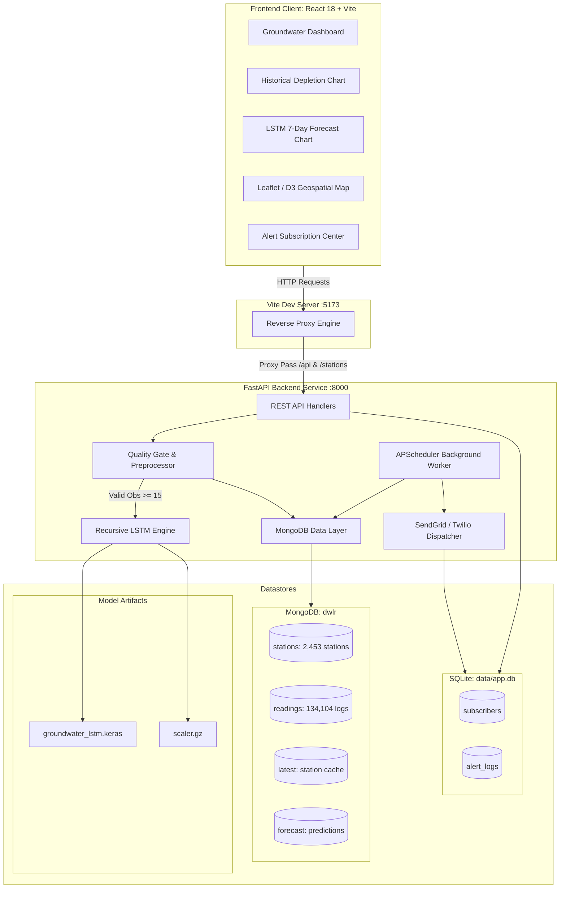

# 💧 JalDrishti — Groundwater Monitoring & Forecasting System

<p align="center">
  
  
  
  
  
  
</p>

> **JalDrishti (जल दृष्टि)** is an end-to-end, full-stack groundwater resource monitoring, analysis, and deep-learning forecasting platform developed for **Madhya Pradesh, India**. Built originally for the **Smart India Hackathon (SIH 2025)** and expanded for state-scale deployment, JalDrishti ingests real-time Digital Water Level Recorder (DWLR) telemetry, tracks aquifer depletion, projects recursive 7-day water table trends using an LSTM neural network, and automates emergency alerts.

---

## 🎥 Demo Video & Visuals

### 📹 Walkthrough Video
🎬 **[Watch the JalDrishti Demonstration Video](./demo.mp4)** *(or via [GitHub Repository Video](https://github.com/shita888/Real-time-ground-water-evaluation-using-DWLR/blob/main/demo.mp4))*

---

### 📸 Application Screenshots

| Alert Subscription & Notifications | Geospatial DWLR Station Mapping |
| :---: | :---: |
|  |  |
| **District-Level Water Analytics** | **Real-Time Station History & Trends** |
|  |  |

---

## 🏆 Smart India Hackathon (SIH 2025) Context

- **Problem Statement:** Real-Time Groundwater Resource Evaluation, Monitoring, and Forecasting using DWLR-style Data Pipelines.
- **Project Domain:** Ministry of Jal Shakti / Central Ground Water Board (CGWB) & Water Resource Management.
- **Coverage:** **55 Districts** of Madhya Pradesh across **2,453 DWLR Telemetry Stations** and **134,104+ Observations**.
- **Recognition:** Successfully cleared internal college selection rounds for SIH 2025.

---

## 🌟 Key Features & Capabilities

- 📡 **Real-Time Telemetry Ingestion:** Automated ingestion pipeline capturing Depth-to-Water-Level readings (in meters below ground level, *mbgl*).
- 🏷️ **CGWB Stage Categorization:** Automated station classification according to Central Ground Water Board criteria:
  - 🟢 **Safe:** `< 10.0 mbgl`
  - 🟡 **Semi-Critical:** `10.0` to `20.0 mbgl`
  - 🟠 **Critical:** `20.0` to `40.0 mbgl`
  - 🔴 **Over-Exploited:** `> 40.0 mbgl`
- 🧠 **LSTM Neural Network Forecasting:** Trained recursive deep learning model forecasting 7-day forward groundwater trends with MinMax normalization.
- 🛡️ **Data Quality Gate:** Strict minimum observation validation ($\ge 15$ valid readings) prevents dummy zero-fillings ($0.0\text{m}$) and returns clear descriptive HTTP 422 feedback.
- 🗺️ **Interactive Geospatial Visualization:** Leaflet + D3.js powered map with color-coded depletion clusters across all 55 districts of Madhya Pradesh.
- 🔔 **Multi-Channel Proactive Alerting:** Threshold-triggered Email (SendGrid) and SMS (Twilio) alerts with a built-in 1-hour anti-flood cooldown managed by APScheduler.
- 🌐 **Multilingual & Accessible UI:** Intuitive interface supporting **7 Indian languages** and dark/light themes.

---

## 🏗️ High-Level Architecture



---

## 📊 Dataset & District Breakdown (Madhya Pradesh)

Data collected from the **Central Ground Water Board (CGWB)**, Ministry of Jal Shakti, and the **Madhya Pradesh Water Resources Department** spanning 1994 to 2024:

| Metric | Empirical Count |
| :--- | :--- |
| **Total Districts Covered** | **55 Districts** (Indore, Bhopal, Ujjain, Jabalpur, Gwalior, Sagar, Dhar, etc.) |
| **Active Telemetry Stations** | **2,453 DWLR Stations** |
| **Total Ingested Observations** | **134,104 Time-Series Records** |
| **Clean Master Dataset** | `backend/data/mp_groundwater_clean.csv` (13.45 MB, 137,255 rows, 0 nulls) |
| **Data Attributes** | State, District, Block, Village, Lat, Lng, Date, WaterLevel, Status, Trend |

---

## 🛠️ Technology Stack

| Layer | Technologies |
| :--- | :--- |
| **Backend & APIs** | Python 3.10+ / 3.13, FastAPI, Uvicorn (ASGI), APScheduler |
| **Machine Learning** | TensorFlow / Keras (LSTM), Scikit-learn (`MinMaxScaler`), Pandas, NumPy |
| **Primary Database** | MongoDB Atlas / Local Community Server 8.0 (Database: `dwlr`) |
| **Metadata Database** | SQLite (`data/app.db`) via SQLAlchemy 2.0 ORM |
| **Frontend Framework** | React 18, TypeScript, Vite, Tailwind CSS 4, Bootstrap 5 |
| **Mapping & Charts** | Leaflet 1.9, D3.js 7.9, Lucide React, Custom SVG/Canvas charts |
| **Notification Services**| SendGrid (Email API), Twilio (SMS Gateway) |
| **Ingestion Prototype**| Node.js, Express, Socket.IO (DWLR mock stream) |

---

## 📁 Repository Directory Structure

```text
JalDrishti/
├── backend/
│   ├── app.py                      # FastAPI application entrypoint & routing
│   ├── db.py                       # MongoDB connection & collection handlers
│   ├── requirements.txt            # Python dependencies
│   ├── .env                        # Backend environment configuration
│   ├── data/
│   │   ├── mp_groundwater_clean.csv# Master MP dataset (134k+ observations)
│   │   └── app.db                  # SQLite database for alert subscribers
│   ├── models/
│   │   ├── groundwater_lstm.keras  # Trained TensorFlow LSTM model (19,009 params)
│   │   ├── scaler.gz               # Scikit-learn MinMaxScaler artifact
│   │   └── user.py                 # Pydantic schemas & SQLAlchemy models
│   ├── services/
│   │   ├── forecast_service.py     # Recursive 7-day inference logic
│   │   ├── notification_service.py # SendGrid email & Twilio SMS delivery
│   │   └── preprocessing.py        # Data cleaning & 15-observation quality gate
│   └── tests/                      # Pytest test cases
├── frontend/
│   ├── src/
│   │   ├── components/             # Reusable UI components
│   │   │   ├── GroundwaterDashboard.tsx # Main overview dashboard
│   │   │   ├── ForecastViewer.tsx       # LSTM forecast graph & quality alerts
│   │   │   ├── HistoryViewer.tsx        # Historical time-series visualizer
│   │   │   └── ui/                      # Navigation, forms, buttons
│   │   ├── districts/              # Leaflet geospatial mapping & district views
│   │   ├── App.tsx                 # Root application component
│   │   └── main.tsx                # React entrypoint
│   ├── package.json                # Frontend dependencies
│   └── vite.config.ts              # Vite dev server configuration & API proxy
├── dwlr-proto/                     # Realtime DWLR telemetry ingestion prototype
│   ├── server.js                   # Node.js Express & Socket.IO server
│   └── package.json
├── JalDrishti_Technical_Report.md  # Comprehensive technical documentation report
└── README.md                       # Project overview and setup documentation
```

---

## ⚡ Quick Start & Local Setup

### Prerequisites
- **Python 3.10+** (Tested on Python 3.10 – 3.13)
- **Node.js 18+** & **npm**
- **MongoDB** running locally on port `27017` or a **MongoDB Atlas** cluster URI

---

### 1️⃣ Clone the Repository
```bash
git clone https://github.com/shita888/Real-time-ground-water-evaluation-using-DWLR.git JalDrishti
cd JalDrishti
```

---

### 2️⃣ Backend Setup (FastAPI & ML Service)

1. Open a terminal and navigate to the backend directory:
   ```bash
   cd backend
   ```

2. Create and activate a Python virtual environment:
   - **Windows (PowerShell):**
     ```powershell
     python -m venv .venv
     .\.venv\Scripts\Activate.ps1
     ```
   - **Linux / macOS:**
     ```bash
     python3 -m venv .venv
     source .venv/bin/activate
     ```

3. Install required packages:
   ```bash
   pip install -r requirements.txt
   ```

4. Configure your `.env` file (see [Environment Variables](#-environment-variables)):
   ```bash
   cp .env.example .env   # Or create .env manually
   ```

5. Start the FastAPI ASGI server:
   ```bash
   uvicorn app:app --reload --host 127.0.0.1 --port 8000
   ```
   > 🟢 Backend will be running at `http://127.0.0.1:8000`  
   > 📖 Swagger API Documentation: `http://127.0.0.1:8000/docs`

---

### 3️⃣ Frontend Setup (React + Vite)

1. Open a new terminal and navigate to the frontend directory:
   ```bash
   cd frontend
   ```

2. Install Node dependencies:
   ```bash
   npm install
   ```

3. Launch the Vite development server:
   ```bash
   npm run dev
   ```
   > 🌐 Frontend will be accessible at `http://localhost:5173`

---

### 4️⃣ Real-Time Telemetry Prototype (Optional)

To simulate continuous DWLR sensor telemetry streams:
```bash
cd dwlr-proto
npm install
npm start
```

---

## 🔑 Environment Variables

### Backend (`backend/.env`)
```ini
# Database Connections
MONGODB_URI=mongodb://localhost:27017/
MONGODB_DB=dwlr
DATABASE_URL=sqlite:///./data/app.db

# Security & Background Triggers
DEV_TRIGGER_TOKEN=dev-secret

# Email Alerts (SendGrid / SMTP)
SENDGRID_API_KEY=your_sendgrid_api_key
FROM_EMAIL=alerts@jaldrishti.gov.in

# SMS Alerts (Twilio)
TWILIO_ACCOUNT_SID=your_twilio_sid
TWILIO_AUTH_TOKEN=your_twilio_auth_token
TWILIO_PHONE_NUMBER=+1234567890

# Cooldown Settings
ALERT_COOLDOWN_SECONDS=3600
```

### Ingestion Prototype (`dwlr-proto/.env`)
```ini
MONGODB_URI=mongodb://localhost:27017/
MONGODB_DB=dwlr
PORT=4000
INGEST_TOKEN=telemetry-secret-token
```

---

## 📡 API Reference

| Method | Endpoint | Parameters | Description |
| :--- | :--- | :--- | :--- |
| `GET` | `/health` | None | Verify backend and MongoDB connection status |
| `GET` | `/statistics` | None | Overall statistics: total, safe, critical, semi-critical counts |
| `GET` | `/stations` | None | Full catalog of all 2,453 MP stations with location and status |
| `GET` | `/stations/recent` | `limit: int = 8` | Returns the most recently updated stations |
| `GET` | `/stations/nearby` | `lat, lon, limit: int = 3` | Returns nearest DWLR stations across distinct districts |
| `GET` | `/latest/{station_id}` | `station_id` (path) | Latest water level observation for a station |
| `GET` | `/history/{station_id}` | `station_id` (path), `days` | Historical time-series observations (failsafe for 0 obs) |
| `GET` | `/forecast/{station_id}` | `station_id` (path), `n_future: int = 7` | **LSTM 7-day predictive forecast** (Requires $\ge 15$ obs, else HTTP 422) |
| `POST` | `/api/subscribe` | JSON Body | Register a new user for critical groundwater threshold alerts |
| `GET` | `/api/subscribers` | None | View active notification subscribers |
| `POST` | `/api/trigger-alerts` | Header: `X-Dev-Trigger` | Manually evaluate thresholds and dispatch alerts with cooldown |

---

## 🧠 Machine Learning: LSTM Forecast Architecture

The forecasting engine utilizes a specialized Keras Sequential architecture:
- **Lookback Window:** 15 historical timesteps ($t-14, \dots, t$)
- **Forecast Horizon:** 7 future days ($t+1, \dots, t+7$) computed recursively
- **Input Dimension:** Shape `(None, 15, 1)`
- **Network Layers:**
  1. `LSTM(64 units, activation='tanh')` — 16,896 parameters
  2. `Dense(32 units, activation='relu')` — 2,080 parameters
  3. `Dense(1 unit, activation='linear')` — 33 parameters
- **Total Parameters:** 19,009 trainable parameters
- **Preprocessing Pipeline:** Normalized using `MinMaxScaler` fitted on empirical range $[0.0\text{m}, 199.75\text{m}]$. Predictions are inverse-transformed to physical meters below ground level (*mbgl*).

---

## 🧪 Testing

To run the automated backend test suite:
```bash
cd backend
pytest tests/
```

To build and check frontend production compilation:
```bash
cd frontend
npm run build
```

---

## 🤝 Contributing & Hackathon Details

- **Project:** JalDrishti (SIH 2025 / Major Project G3)
- **Problem Statement:** Real-Time Groundwater Resource Evaluation using DWLR Telemetry
- **Demo Repository:** [Real-time-ground-water-evaluation-using-DWLR](https://github.com/shita888/Real-time-ground-water-evaluation-using-DWLR)
- **License:** Open Source for academic and public water governance initiatives.
