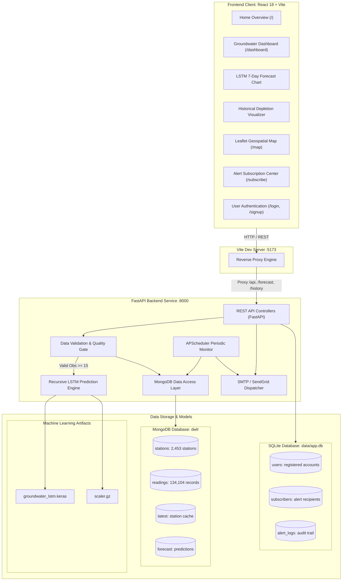

# 💧 JalDrishti — Real-Time Groundwater Monitoring & Deep-Learning Forecasting

<p align="center">
  
  
  
  
  
  
  
</p>

> **JalDrishti (जल दृष्टि)** is an end-to-end, state-scale groundwater resource evaluation, monitoring, and predictive forecasting platform engineered for **Madhya Pradesh, India**. Developed originally for the **Smart India Hackathon (SIH 2025)** under the aegis of the Ministry of Jal Shakti and Central Ground Water Board (CGWB), JalDrishti ingests telemetry from Digital Water Level Recorders (DWLR), classifies aquifer depletion stages, generates recursive 7-day water table forecasts using a trained LSTM neural network, and automates emergency alerts across email and SMS channels.

---

## 🎥 Walkthrough Video & Visual Showcase

### 📹 Demonstration Video
🎬 **[Watch the JalDrishti Video Walkthrough](./demo.mp4)** *(or via [GitHub Repository Video](https://github.com/shita888/Real-time-ground-water-evaluation-using-DWLR/blob/main/demo.mp4))*

---

### 📸 Application Interface

| Alert Subscription & Notifications | Interactive Geospatial Station Map |
| :---: | :---: |
|  |  |
| **District-Level Groundwater Analytics** | **Station Telemetry & Depletion History** |
|  |  |

---

## 🏆 Smart India Hackathon (SIH 2025) Context

- **Problem Statement:** Real-Time Groundwater Resource Evaluation, Monitoring, and Forecasting using DWLR-style Data Pipelines.
- **Project Domain:** Ministry of Jal Shakti / Central Ground Water Board (CGWB) & Water Resource Governance.
- **Geographic Scope:** **55 Districts** of Madhya Pradesh across **2,453 DWLR Telemetry Stations** and **134,104+ Observations**.
- **Recognition:** Successfully cleared internal college selection rounds for SIH 2025.

---

## 🌟 Key Capabilities & System Features

- 📡 **Automated DWLR Telemetry Ingestion:** Continuous ingestion pipeline tracking Depth-to-Water-Level readings in meters below ground level (*m bgl*).
- 🏷️ **CGWB-Standard Depletion Classification:** Automated categorization based on Central Ground Water Board benchmarks:
  - 🟢 **Safe:** `< 5.0 m bgl` (Normal seasonal recharge)
  - 🟡 **Semi-Critical:** `5.0 m` to `10.0 m bgl` (Accelerating depletion trend)
  - 🔴 **Critical / Over-Exploited:** `> 20.0 m bgl` (Urgent replenishment advisory)
- 🧠 **Recursive Deep-Learning LSTM Forecasting:** Trained TensorFlow/Keras LSTM model forecasting 7-day future groundwater levels with MinMax scaling.
- 🛡️ **Zero-Hallucination Quality Gate:** Enforces minimum observation validation ($\ge 15$ valid empirical readings). Failsafe handling prevents fake dummy numbers ($0.0\text{m}$) and returns structured HTTP 422 feedback.
- 🗺️ **Geospatial Mapping & Analytics:** Interactive Leaflet + D3.js mapping with color-coded depletion clusters across all 55 districts of Madhya Pradesh.
- 🔔 **Intelligent Alert Dispatch:** Automated alert subscription engine supporting both Gmail SMTP (with responsive HTML confirmation emails) and SendGrid, accompanied by Twilio SMS support and a 1-hour anti-flood cooldown.
- 👤 **Account Authentication & Profile Sync:** Complete user authentication system (`/login`, `/signup`, `/forgot-password`) that auto-fills subscription preferences and links notifications with registered profiles.
- 🌐 **Multilingual & Responsive UI:** Unified navigation featuring **Home (`/`)**, **Dashboard (`/dashboard`)**, **Map (`/map`)**, and **About (`/about`)** with dark/light theme support.

---

## 🏗️ High-Level System Architecture



---

## 📊 Dataset & State Coverage (Madhya Pradesh)

Dataset compiled from the **Central Ground Water Board (CGWB)**, Ministry of Jal Shakti, and the **Madhya Pradesh Water Resources Department**:

| Metric | Verified Metric Count |
| :--- | :--- |
| **Districts Covered** | **55 Districts** (Indore, Bhopal, Ujjain, Jabalpur, Gwalior, Sagar, Dhar, etc.) |
| **Active DWLR Stations** | **2,453 Telemetry Stations** |
| **Time-Series Observations** | **134,104 Logged Observations** |
| **Clean Master Dataset** | `backend/data/mp_groundwater_clean.csv` (13.45 MB, 137,255 rows, 0 nulls) |
| **Observed Fields** | State, District, Block, Village, Latitude, Longitude, Date, WaterLevel, Status, Trend |

---

## 🛠️ Technology Stack

| Domain | Technologies & Libraries |
| :--- | :--- |
| **Backend Framework** | Python 3.10+ / 3.13, FastAPI 0.115+, Uvicorn (ASGI), Pydantic v2, APScheduler |
| **Machine Learning** | TensorFlow 2.18 / Keras (LSTM), Scikit-learn (`MinMaxScaler`), Pandas, NumPy |
| **Primary Datastore** | MongoDB Community Server 8.0 / Atlas (Database: `dwlr`) |
| **Metadata & Auth DB**| SQLite 3 (`data/app.db`) via SQLAlchemy 2.0 ORM (PBKDF2 SHA-256 password hashing) |
| **Frontend Framework**| React 18, TypeScript, Vite 6, Tailwind CSS v4, Lucide React Icons |
| **Mapping & Analytics**| Leaflet 1.9, D3.js 7.9, React-Leaflet 4.2 |
| **Email & SMS Alerts** | Python `smtplib` (Gmail App Passwords / TLS 587 / SSL 465), SendGrid API, Twilio SMS |
| **Ingestion Prototype**| Node.js 18+, Express, Socket.IO |

---

## 📁 Repository Directory Structure

```text
JalDrishti/
├── backend/
│   ├── app.py                      # FastAPI application entrypoint & API routes
│   ├── db.py                       # MongoDB connection & collection handlers
│   ├── requirements.txt            # Python dependencies
│   ├── .env.example                # Backend environment configuration template
│   ├── data/
│   │   ├── mp_groundwater_clean.csv# Master MP dataset (134,104+ observations)
│   │   └── app.db                  # SQLite database for accounts & subscribers
│   ├── models/
│   │   ├── groundwater_lstm.keras  # Trained TensorFlow LSTM model (19,009 params)
│   │   ├── scaler.gz               # Fitted MinMaxScaler artifact
│   │   ├── user.py                 # SQLAlchemy User model (PBKDF2 auth)
│   │   ├── subscriber.py           # Alert subscriber model
│   │   └── alert_log.py            # Alert delivery audit logs
│   ├── services/
│   │   ├── forecast.py             # Recursive 7-day LSTM inference engine
│   │   ├── preprocess.py           # Quality gate & observation sanitizer
│   │   ├── db.py                   # MongoDB data access layer & queries
│   │   ├── email_service.py        # SMTP / SendGrid dispatcher & HTML templates
│   │   ├── sms_service.py          # Twilio SMS gateway dispatcher
│   │   └── scheduler.py            # Background periodic threshold evaluator
│   └── tests/
│       └── test_api.py             # Pytest automated test suite
├── frontend/
│   ├── src/
│   │   ├── components/             # Reusable UI components
│   │   │   ├── GroundwaterDashboard.tsx # Overview dashboard & metrics
│   │   │   ├── ForecastViewer.tsx       # 7-day forecast chart with 20m threshold
│   │   │   ├── HistoryViewer.tsx        # Historical time-series visualizer
│   │   │   ├── AlertSubscription.tsx    # Subscription center with login sync
│   │   │   ├── home.tsx                 # Landing page & overview
│   │   │   └── ui/                      # AppSidebar, Header, LoginPage, SignupPage
│   │   ├── districts/
│   │   │   └── district.tsx             # Interactive Leaflet map of MP districts
│   │   ├── pages/
│   │   │   ├── Index.tsx                # Home page route wrapper
│   │   │   ├── ForecastPage.tsx         # Dedicated Forecast page
│   │   │   ├── HistoryPage.tsx          # Dedicated History page
│   │   │   └── DistrictsDataPage.tsx    # District breakdown page
│   │   ├── services/
│   │   │   └── api.ts                   # Centralized API fetch handlers & types
│   │   ├── App.tsx                      # React Router configuration
│   │   ├── main.tsx                     # React application entrypoint
│   │   └── index.css                    # Tailwind CSS v4 design tokens
│   ├── package.json                     # Frontend dependencies
│   ├── vite.config.ts                   # Vite dev server & proxy settings
│   └── .env.example                     # Frontend environment template
├── dwlr-proto/                          # Realtime DWLR telemetry ingestion prototype
│   ├── server.js                        # Node.js Express & Socket.IO server
│   └── package.json
├── JalDrishti_Technical_Report.md       # Comprehensive technical evaluation report
└── README.md                            # Project documentation
```

---

## ⚡ Quick Start & Local Setup

### Prerequisites
- **Python 3.10+** (Tested on Python 3.10, 3.11, 3.12, 3.13)
- **Node.js 18+** & **npm**
- **MongoDB** Community Server 8.0 running locally on port `27017` (or MongoDB Atlas)

---

### 1️⃣ Clone the Repository
```bash
git clone https://github.com/shita888/Real-time-ground-water-evaluation-using-DWLR.git JalDrishti
cd JalDrishti
```

---

### 2️⃣ Backend Setup (FastAPI & ML Service)

1. Open a terminal and navigate to the backend directory:
   ```bash
   cd backend
   ```

2. Create and activate a Python virtual environment:
   - **Windows (PowerShell):**
     ```powershell
     python -m venv .venv
     .\.venv\Scripts\Activate.ps1
     ```
   - **Linux / macOS:**
     ```bash
     python3 -m venv .venv
     source .venv/bin/activate
     ```

3. Install backend dependencies:
   ```bash
   pip install -r requirements.txt
   ```

4. Create your local environment configuration:
   ```powershell
   Copy-Item .env.example .env    # Windows PowerShell
   # OR: cp .env.example .env     # Linux / macOS
   ```

5. Launch the FastAPI backend server:
   ```bash
   python -m uvicorn app:app --reload --host 127.0.0.1 --port 8000
   ```
   > 🟢 Backend running at: `http://127.0.0.1:8000`  
   > 📖 Swagger API Documentation: `http://127.0.0.1:8000/docs`

---

### 3️⃣ Frontend Setup (React + Vite)

1. Open a new terminal and navigate to the frontend directory:
   ```bash
   cd frontend
   ```

2. Install Node packages:
   ```bash
   npm install
   ```

3. Start the Vite development server:
   ```bash
   npm run dev
   ```
   > 🌐 Frontend available at: `http://localhost:5173`

---

### 4️⃣ Real-Time Telemetry Prototype (Optional)

To simulate continuous DWLR telemetry ingestion:
```bash
cd dwlr-proto
npm install
npm start
```

---

## 🔑 Environment Configuration

### Backend (`backend/.env`)
```ini
# Datastore Configuration
MONGODB_URI=mongodb://127.0.0.1:27017/
MONGODB_DB=dwlr
DATABASE_URL=sqlite:///data/app.db

# Dev Controls & Cooldown
DEV_TRIGGER_TOKEN=dev-secret
DISABLE_SCHEDULER=true
ALERT_COOLDOWN_SECONDS=3600
CRITICAL_LEVEL=15.0

# Email Delivery (Gmail SMTP - Free & Recommended)
# 1. Enable 2-Step Verification in Google Account.
# 2. Generate a 16-character App Password at: https://myaccount.google.com/apppasswords
SMTP_HOST=smtp.gmail.com
SMTP_PORT=587
SMTP_USER=your-email@gmail.com
SMTP_PASS=xxxx xxxx xxxx xxxx
EMAIL_FROM=your-email@gmail.com

# Alternative: SendGrid API
# SENDGRID_API_KEY=SG.xxxxxxxxxxxxxxxxxxxx
# EMAIL_FROM=verified-sender@yourdomain.com
```

### Frontend (`frontend/.env`)
```ini
# Optional: OpenAI API Key for the in-app JalDrishti Chatbot assistant
VITE_OPENAI_API_KEY=your_openai_api_key_here
```

---

## 📡 REST API Reference

| HTTP Method | Route | Parameters | Description |
| :--- | :--- | :--- | :--- |
| `GET` | `/health` | None | Service health, timestamp, and MongoDB connectivity status |
| `GET` | `/statistics` | None | Overall metrics: total, safe, critical, and semi-critical counts |
| `GET` | `/stations` | None | Catalog of all 2,453 MP stations with geographic coordinates |
| `GET` | `/stations/recent` | `limit: int = 8` | Returns the most recently updated telemetry stations |
| `GET` | `/stations/nearby` | `lat, lon, limit: int = 3` | Returns nearest DWLR stations across distinct districts |
| `GET` | `/latest/{station_id}` | `station_id` (path) | Latest water level observation for a specified station |
| `GET` | `/history/{station_id}` | `station_id` (path), `days` | Historical time-series observations (failsafe for 0 obs) |
| `GET` | `/forecast/{station_id}`| `station_id` (path), `n_future` | **Recursive 7-day LSTM forecast** (Requires $\ge 15$ obs, else HTTP 422) |
| `POST` | `/api/subscribe` | JSON Body | Subscribe user to alerts & dispatch confirmation email |
| `GET` | `/api/subscribers` | None | List registered notification subscribers |
| `POST` | `/api/auth/signup` | `name, email, password` | Register a new user account with PBKDF2 hashing |
| `POST` | `/api/auth/login` | `email, password` | Authenticate user and issue session token |
| `POST` | `/api/auth/forgot-password` | `email` | Request a password reset code via email |
| `POST` | `/api/auth/reset-password` | `email, token, new_password`| Reset account password using token |

---

## 🧠 Machine Learning: LSTM Forecast Architecture

The forecasting engine uses a specialized Keras Sequential architecture:
- **Lookback Window:** 15 historical consecutive timesteps ($t-14, \dots, t$)
- **Forecast Horizon:** 7 forward days ($t+1, \dots, t+7$) computed recursively
- **Input Shape:** `(None, 15, 1)`
- **Network Layers:**
  1. `LSTM(64 units, activation='tanh', return_sequences=False)` — 16,896 parameters
  2. `Dense(32 units, activation='relu')` — 2,080 parameters
  3. `Dense(1 unit, activation='linear')` — 33 parameters
- **Total Parameters:** 19,009 trainable parameters
- **Scaling Pipeline:** Normalized with `MinMaxScaler` fitted on empirical range $[0.0\text{m}, 199.75\text{m}]$. Predictions are inverse-transformed to physical meters below ground level (*m bgl*).
- **Quality Gate:** If a station has fewer than 15 valid readings, forecasting rejects the request with HTTP 422 showing available and required counts, preventing hallucinated predictions.

---

## 🧪 Testing & Verification

Run the automated backend test suite with Pytest:
```bash
cd backend
pytest tests/
```

Verify frontend production compilation:
```bash
cd frontend
npm run build
```

---

## 🤝 Project Information

- **Project:** JalDrishti (जल दृष्टि) — SIH 2025 / Major Project G3
- **Objective:** Real-Time Groundwater Telemetry Evaluation & LSTM Forecasting
- **GitHub Repository:** [https://github.com/shita888/Real-time-ground-water-evaluation-using-DWLR](https://github.com/shita888/Real-time-ground-water-evaluation-using-DWLR)
- **License:** Open Source for educational, research, and public water governance initiatives.
